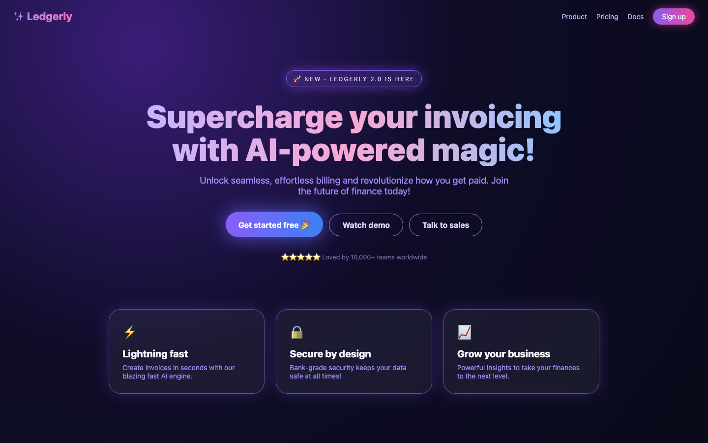
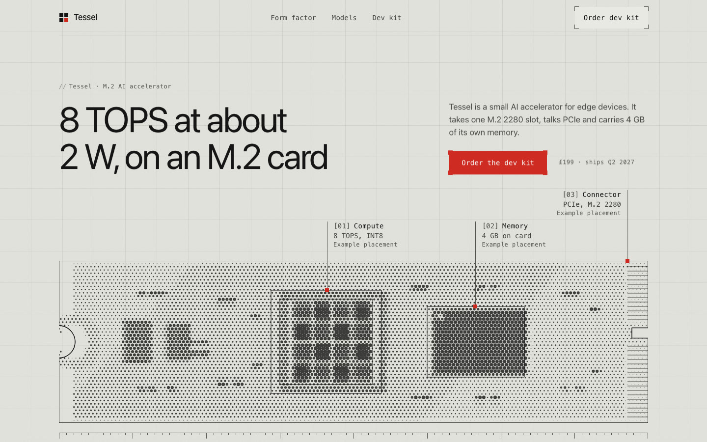
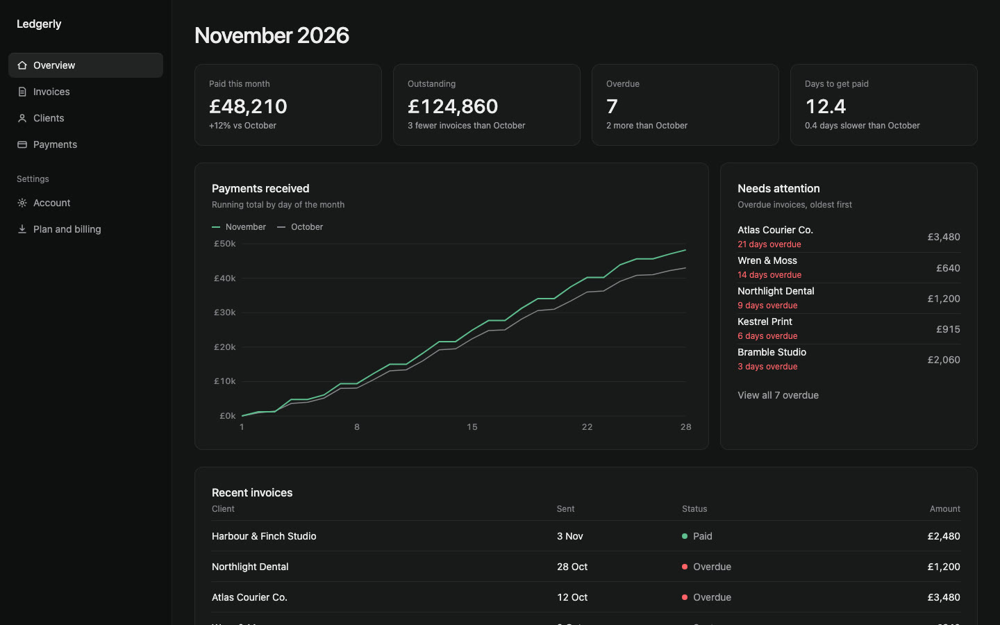
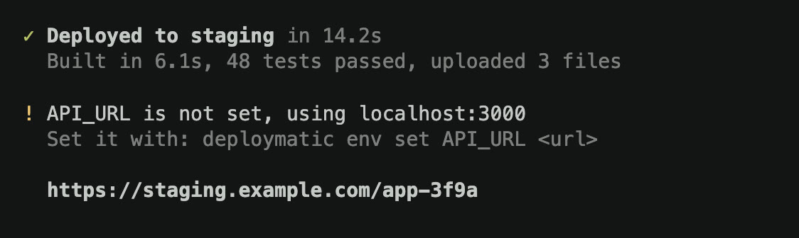

<h1 align="center">Inimitable</h1>

<p align="center"><strong>Design that looks like it was made on purpose.</strong><br>
A skill for coding agents. It builds and repairs interfaces, then checks them in a real browser before it shows you.</p>

<p align="center">
  <a href="LICENSE"></a>
  
  
  <a href="https://skills.sh/koryei/inimitable"></a>
  <a href="https://koryei.github.io/Inimitable/"></a>
  <a href="CHANGELOG.md"></a>
</p>

<p align="center">
  
  
</p>
<p align="center"><sub>Same product, same content. Left: what you get when nobody decides anything. Right: after one run. <a href="examples/landing">See both pages and the measurements.</a></sub></p>

---

Ask an agent for a screen and you usually get the same one: a purple gradient, a glowing badge, an emoji on every label and spacing nobody chose. It works, and it looks like everything else.

Inimitable changes what happens between your request and the result. The agent reads your project first and decides what the screen is for. It builds the screen section by section, then **opens it in a real browser at four sizes, measures it and fixes what it finds before it shows you anything.** What you get back is ready for taste feedback, not for cleanup.

Throughout this page, a **tell** is a mark of machine-made UI: a purple gradient, a glowing badge, an emoji label.

## What you get

- **Your rules come first.** Your brand guide, tokens and design notes outrank the skill’s own taste. It never repaints a product in a style that isn’t yours.
- **Decisions, not interrogation.** A vague request gets one stated reading and a start, not a list of questions.
- **Fixes in a fixed order.** Spacing, colour, icons, copy, type, layout, details, then motion. Each layer is finished across the whole screen before the next, so fixes never fight each other.
- **One star per screen.** Every new screen has one thing that is clearly the point, and everything else steps back. A brand with no accent colour makes its star with size and contrast.
- **Measurement, not guesses.** Included scripts count the font sizes, radii, colours and spacing values in use, find tells by name, and check contrast and touch targets from the rendered pixels.
- **A look before the show.** It renders the real screen at 320, 390, 1440 and 2560 px (terminal UI at 60 and 120 columns), hovers every control, and fixes up to three rounds of problems.
- **A check for what feels cheap.** Silent failures, dead-end empty states, vague errors, permission prompts before value and truncated text that matters: it walks a six-area checklist on the running screen, not just the pixels.
- **Parts worth taking.** A catalogue of component, motion and design-system sources (Bencho, Transitions.dev, BoardUI, Astryx, Aceternity, ObsidianUI, HorizonX) and of places to study real products (Mobbin, 21st.dev, react.dev), with the rules for taking from them: ask first, check the licence, re-skin to your tokens.
- **Plain reports.** Short, with real before and after numbers. It names anything it could not fix.

## Where it works

| Surface | What it is tuned for |
| --- | --- |
| **Web apps and dashboards** | Density, scanning, familiar controls, and honest empty, loading and error states. |
| **Landing and marketing pages** | One clear promise, one visual that shows something true and one action. |
| **Reading and docs** | Comprehension first, then a reading experience worth staying in. |
| **Showpieces and portfolios** | The work leads from the first screen and the interface recedes. |
| **Terminal UI** | Result first, colour that means something, width discipline, and it works without colour. |
| **Native mobile** | iOS and Android conventions, touch targets, platform motion and accessibility. |

## See it work

**Technical landing pages in the instrument style.** A dotted, annotated hero object, corner brackets, `//` labels and one accent, with every drawn label marked as an example. Two briefs with strict no-invention rules: [encrypted messaging](examples/instrument-messaging) (mechanical score from 68 to 100) and [an AI accelerator chip](examples/instrument-chip) (from 43 to 94).

<p align="center">
  
  
</p>

**A dashboard.** From 92 tells (9 kinds) to none. Spacing values off the 4 px grid fell from 17 to 0, weights from 3 to 2 and colour hues from 8 to 2, and the page no longer scrolls sideways on a phone. The first attempt failed three of the skill’s own checks, and the look step caught and fixed them. [Open the example.](examples/dashboard)

<p align="center">
  
  
</p>

**A landing page.** From 36 tells (12 kinds) to none. Font sizes fell from 9 to 6, weights from 4 to 2, and spacing values off the 4 px grid from 15 to 0. [Open the example.](examples/landing)

**A terminal command.** Same information, result first: 13 lines became 7, 14 emoji became none, nothing wraps at 60 columns, and it reads with colour switched off. [Open the example.](examples/terminal)

<p align="center">
  
  
</p>

## Install

```bash
npx skills add koryei/Inimitable
```

This uses the [skills CLI](https://skills.sh) and installs into Claude Code, Codex, Cursor and the other agents you have. Add `-g` to install for every project, or `-a claude-code` to pick one agent. The skill is listed on [skills.sh](https://skills.sh/koryei/inimitable).

To keep a clone you can update with `git pull`:

```bash
git clone https://github.com/koryei/Inimitable.git
cd Inimitable && ./install.sh
```

`install.sh` links the folder into `~/.claude/skills/inimitable`. Add `--codex` for Codex, `--dir <path>` for any agent that reads `SKILL.md` folders, `--check` to test your setup, or `--uninstall` to remove it.

**You need** Node 22 or newer and an installed Chrome, Edge or Chromium (set `CHROME_PATH` if it is somewhere unusual). Terminal screenshots also use Python 3, which macOS and most Linux systems already have. There are no packages to install and no API keys to set.

## Use it

Describe the job. The skill loads when the work is design.

```text
Build a pricing page for this app.
Fix the settings screen. It looks generated.
Make the CLI output look designed.
Polish the onboarding flow on phone and desktop.
Review this screen against our brand guide.
```

## How a run goes

| | Step | What happens |
| --- | --- | --- |
| 1 | **Read** | Finds your design rules, watches the screens run and measures the drift. |
| 2 | **Decide the mode** | Persuade, Operate, Read, Experience or Terminal: what the person is doing here. |
| 3 | **Fix the direction** | Five lines on how it should feel and what it must never look like. |
| 4 | **Branch** | Repairs an existing screen layer by layer, or builds a new one around one star. |
| 5 | **Build** | One section at a time, from your own components, with every state designed. |
| 6 | **Gate** | Runs your lint, types and tests, then measures contrast, target size and tells. |
| 7 | **Look** | Renders at four widths and fixes what shows, for up to three rounds. |
| 8 | **Report** | Short and honest, with real before and after numbers. |
| 9 | **Log** | Puts lessons in your project’s notes. The skill never edits itself. |

## Start from a tested page

A blank file is how a page ends up static and generic. For a new screen the agent starts from one of two complete starters, then makes it the product’s own. Both pass every check in the skill, in dark and light, at all four widths.

```bash
node scripts/scaffold.mjs my-page --theme light --palette ember --shape contour
node scripts/scaffold.mjs my-app --kind app --theme dark
```

| Starter | What you get |
| --- | --- |
| **Landing page** | A lit grainient ground, a floating nav, a product frame, an uneven bento, steps, one big number, a closing call and a footer. The motion kit is wired in: ordered entrance, scroll reveals, count-up, and a hover and press state on every control. |
| **App screen** (`--kind app`) | A sidebar that becomes a menu on a phone, a page header with one primary action, four key numbers, one chart, a table whose status is a word and a dot, and an empty state that says what to do. |

Seven grounds are built in (`--shape pools`, `horizon`, `bowl`, `blob`, `sweep`, `rays` or `contour`). Add `--hero split` to put the headline beside the one object only your product has, or `--minimal` for a short brief with few facts. Every placeholder is marked `data-todo`, and `signs.mjs` reports any left, so unfinished copy cannot ship.

## The tools

Plain Node scripts with no dependencies. The agent runs them for you, and you can run them yourself on any page or file.

| Script | What it does | Useful flags |
| --- | --- | --- |
| `scripts/shoot.mjs <url or file>` | Screenshots at 320, 390, 1440 and 2560 px. Flags sideways scrolling and console errors. | `--eval` sets up a state first, `--slices` captures every screenful, `--wait` lets animation finish |
| `scripts/drift.mjs <url or file>` | Counts the font sizes, weights, radii, colours and spacing values in use, and flags drift. | `--save` and `--against` give a before and after |
| `scripts/signs.mjs <url or file>` | Finds tells in the rendered page: hue gradients, glows, emoji, hype words, unverified claims, looping animation and more. | `--allow` licenses a device your committed direction uses on purpose |
| `scripts/check.mjs <url or file>` | Reads WCAG contrast from the rendered pixels, so gradients, images and pseudo-element backgrounds are judged too. Also checks touch targets, small text, missing names, focus styles, layout shift and document basics. | `--widths` |
| `scripts/craft.mjs <url or file>` | Hovers every control with a real pointer and diffs the result, so a control that ignores the pointer is caught, not missed. Also flags layout-property transitions and motion that ignores the reduced-motion setting. | `--shots` writes a rest and hover crop per control |
| `scripts/scaffold.mjs <folder>` | Starts a landing page or an app screen from a tested starter. | `--kind`, `--theme`, `--palette`, `--shape`, `--hero`, `--minimal` |
| `scripts/inline.mjs <folder>` | Folds a finished page, with its styles, script and fonts, into one file you can send. | `--out page.html` |
| `scripts/lib-add.mjs add <source> <item>` | Pulls real source from Bencho, BoardUI, Aceternity or any shadcn registry. Files only, with the licence notice. | `--dry-run`, `--out` |
| `scripts/dotify.mjs <image or svg>` | Turns a picture or drawn SVG into dithered, halftone, hex-dot or ASCII art for a hero object. | `--invert` |
| `scripts/score.mjs <url or file>` | Runs every check and prints one score out of 100, with what cost points. | |
| `scripts/term-shot.mjs -- <command>` | Runs a terminal program at a set width in a real pseudo-terminal and captures its text and an image. | |

`shoot`, `signs`, `check`, `craft` and `term-shot` exit with a non-zero code when they find a problem, so they also work as gates in CI.

## What is in the box

```text
SKILL.md                 the nine-step run
references/
  read.md … lessons.md   one file per step
  house-rules.md         default numbers for projects with no rules of their own
  anti-slop.md           the tells, each with its fix
  principles.md          why design works: perception, grouping, type, colour, feedback, trust
  visual-craft.md        finding and drawing the one memorable moment in code
  landing-craft.md       why the best landing pages work, with the kit piece that builds each decision
  directions.md          committed looks: instrument dark and light, blueprint, horizon, dithered data
  devices.md             fifteen structural moves that make a page memorable, each with its reason
  feels-cheap.md         trust, feedback, loading, retention, consistency, permissions
  components.md          what a finished component does, state by state
  motion.md              recipes for menus, modals, toasts, tabs and state changes
  hover.md               why a control has to answer, and the mechanics of hover and press
  materials.md           surface, light and grain: the ground a screen sits on
  libraries.md           where to take parts from, and the rules for taking them
  layers/                spacing, colour, icons, copy, type, layout, details, motion
  surfaces/              web app, landing, reading, showpiece, terminal, iOS, Android
assets/motion/           the motion kit: entrance, reveal, count-up, magnetic, tilt, spotlight, marquee, draw, sweep buttons
assets/starters/         the landing and app starters, tested in a browser
assets/fonts/            Geist, Geist Mono and Instrument Serif under the Open Font Licence
assets/recipes/          tested generators and kits: grounds, contours, stones, vessels, dither, halftone, HUD callouts, isometric art
scripts/                 the measuring and building tools above
evals/                   briefs, scoring and the write-up of every test round
examples/                real before and after runs
```

## How it was tested

Each brief was built twice by the same model, once with no skill and once with it. The mechanical score is the skill’s own checks. Side-by-side comparisons were judged by eye.

Across the first three rounds the skill won 9 of 12 comparisons, with a mean mechanical score of 96 against 62. On a later plain brief that never mentioned how it would be judged, the motion and hover score was 75 with the skill and 31 without.

The limits are real: one reviewer, a round that was not blind, and both sides on the same model. The skill lost two comparisons in the first round, because it made clean pages where the other side drew something memorable. The guide and recipes for that one rich moment came from those losses. [Read all five rounds.](evals/results)

## Questions

**Will it override my brand?** No. Your own rules win over everything in the skill. If a tell is part of your brand, such as a gradient in your logo, say so once and it is kept.

**Does it need an image generator?** No. It builds visuals in code. Where an image would help, it writes the prompt and leaves a labelled slot.

**Does it work on existing apps?** Yes, that is the main use. It repairs a screen in your own stack and components, and leaves your product, content and section order alone.

**Does it work without a browser?** It can edit code, but it then says plainly that nothing was rendered. The look step and the measuring scripts need Chrome, Edge or Chromium.

**What does it cost?** Nothing to run: there are no services and no keys. It uses the tokens your agent already spends.

## Contributing

Found a tell it misses, a surface it handles badly or a rule that backfired? Open an issue with a screenshot. [CONTRIBUTING.md](CONTRIBUTING.md) explains how to send a change.

## Licence

Apache 2.0. See [LICENSE](LICENSE) for the terms and [NOTICE.md](NOTICE.md) for credits.
