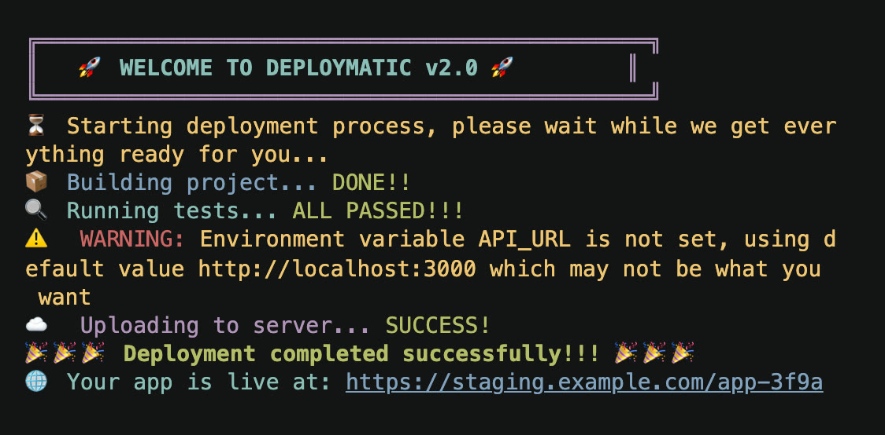

<h1 align="center">Inimitable</h1>

<p align="center"><strong>Design that looks like it was made on purpose.</strong><br>
A skill for coding agents that builds and repairs interfaces until they look right the first time you see them.</p>

<p align="center">
  <a href="LICENSE"></a>
  
  
  <a href="CHANGELOG.md"></a>
</p>

<p align="center">
  
  
</p>
<p align="center"><sub>Same product, same content. Left: what you get when nobody decides anything. Right: after one run. <a href="examples/landing">Both pages and the measurements are in the repo.</a></sub></p>

---

Ask an agent for a screen and you usually get the same one: a purple gradient, a glowing badge, an emoji on every label, spacing nobody chose. It works, and it looks like everything else.

Inimitable changes what happens between your request and the result. The agent reads your project first, decides what the screen is for, builds it section by section, then **opens it in a real browser at four sizes, measures it, and fixes what it finds before it shows you anything.** What you get back is something you only have to give taste feedback on.

## What it does for you

- **Respects what you already have.** Your brand guide, tokens and design notes outrank its own taste. It never repaints a product in a style that isn't yours.
- **Decides, doesn't interrogate.** A vague request gets one stated reading and a start, not a list of questions.
- **Fixes in a fixed order.** Spacing, colour, icons, copy, type, layout, details, motion: each layer across the whole screen before the next, so fixes never fight each other.
- **Builds around one star.** Every new screen has one thing that is clearly the point, and everything else steps back. A brand with no accent colour makes its star with size and contrast.
- **Measures instead of guessing.** Included scripts count the font sizes, radii, colours and spacing values actually in use, find the tells of machine-made UI, and check contrast and touch targets.
- **Looks before it shows.** It renders the real screen at 320, 390, 1440 and 2560 px (terminal UI at 60 and 120 columns) and fixes up to three rounds of problems.
- **Reports in plain words.** Short, with real before and after numbers, and it names anything it could not fix.

## What it covers

| Surface | What it is tuned for |
| --- | --- |
| **Web apps and dashboards** | Density, scanning, familiar controls, and honest empty, loading and error states. |
| **Landing and marketing pages** | One clear promise, one visual that shows something true, one action. |
| **Reading and docs** | Comprehension first, then a reading experience worth staying in. |
| **Showpieces and portfolios** | The work leads from the first screen and the interface recedes. |
| **Terminal UI** | Result first, colour that means something, width discipline, works without colour. |
| **Native mobile** | iOS and Android conventions, touch targets, platform motion and accessibility. |

## See it work

**A landing page.** 12 kinds of machine-made tell (36 in all) down to none. Font sizes 9 → 6, weights 4 → 2, spacing values off the 4 px grid 15 → 0. [Open the example.](examples/landing)

**A terminal command.** Same information, result first: 13 lines to 7, 14 emoji to none, no wrapped lines at 60 columns, readable with colour switched off. [Open the example.](examples/terminal)

<p align="center">
  
  
</p>

## Install

```bash
git clone https://github.com/koryei/Inimitable.git
cd Inimitable && ./install.sh
```

`install.sh` links the folder into `~/.claude/skills/inimitable`, so `git pull` updates it in place. Use `--codex` for Codex, `--dir <path>` for any agent that reads `SKILL.md` folders, `--check` to test your setup, `--uninstall` to remove it.

**Needs** Node 22 or newer and an installed Chrome, Edge or Chromium (set `CHROME_PATH` if it is somewhere unusual). Terminal screenshots also use Python 3, which macOS and most Linux already have. No packages to install and no API keys.

## Use it

Describe the job. The skill loads when the work is design.

```text
Build a pricing page for this app.
Fix the settings screen. It looks generated.
Make the CLI output look designed.
Polish the onboarding flow on phone and desktop.
Review this screen against our brand guide.
```

## How a run goes

| | Step | What happens |
| --- | --- | --- |
| 1 | **Read** | Finds your design rules, sees the screens running, measures the drift. |
| 2 | **Decide the mode** | Persuade, Operate, Read, Experience or Terminal: what the person is doing here. |
| 3 | **Fix the direction** | Five lines on what it should feel like and what it must never look like. |
| 4 | **Branch** | Repair an existing screen layer by layer, or build a new one around one star. |
| 5 | **Build** | One section at a time, from your own components, with every state designed. |
| 6 | **Gate** | Your lint, types and tests, then measured contrast, target size and tell checks. |
| 7 | **Look** | Renders at four widths, fixes what shows, up to three rounds. |
| 8 | **Report** | Short and honest, with real before and after numbers. |
| 9 | **Log** | Lessons go into your project's notes. The skill never changes itself. |

## The tools

Plain Node scripts, no dependencies. The agent runs them for you, and you can run them yourself on any page or file.

| Script | What it does |
| --- | --- |
| `scripts/shoot.mjs <url or file>` | Screenshots at 320, 390, 1440 and 2560 px. Flags sideways scrolling and console errors. |
| `scripts/drift.mjs <url or file>` | Counts the font sizes, weights, radii, colours and spacing values in use and flags drift. `--save` and `--against` give a before and after. |
| `scripts/signs.mjs <url or file>` | Finds machine-made tells in the rendered page: hue gradients, glows, emoji, hype words, unverified claims, looping animation and more. |
| `scripts/check.mjs <url or file>` | WCAG contrast, touch-target size, small text, missing names and document basics, at phone and desktop widths. |
| `scripts/term-shot.mjs -- <command>` | Runs a terminal program at a set width in a real pseudo-terminal and captures text and an image. |

`shoot`, `signs`, `check` and `term-shot` exit non-zero when they find a problem, so they also work as gates in CI.

## What is in the box

```text
SKILL.md                 the nine-step run
references/
  read.md … lessons.md   one file per step
  house-rules.md         default numbers for projects with no rules of their own
  anti-slop.md           the tells, each with its fix
  layers/                spacing, colour, icons, copy, type, layout, details, motion
  surfaces/              web app, landing, reading, showpiece, terminal, iOS, Android
scripts/                 the five tools above
examples/                real before and after runs
```

## Questions

**Will it override my brand?** No. Your own rules win over everything in the skill. Where a tell is part of your brand (a gradient in your logo), say so once and it is kept.

**Does it need an image generator?** No. It builds visuals in code, and where an image would help it writes the prompt and leaves a labelled slot.

**Does it work on existing apps?** Yes, that is the main use. It repairs a screen in your own stack and components, and leaves your product, content and order of sections alone.

**Does it work without a browser?** It can edit code, but then it says plainly that nothing was rendered. The look step and the measuring scripts need Chrome, Edge or Chromium.

**What does it cost?** Nothing to run: no services, no keys. It uses the tokens your agent already spends.

## Contributing

Found a tell it misses, a surface it handles badly, or a rule that backfired? Open an issue with a screenshot. See [CONTRIBUTING.md](CONTRIBUTING.md).

## License

Apache 2.0. See [`LICENSE`](LICENSE) and [`NOTICE.md`](NOTICE.md) for credits.
