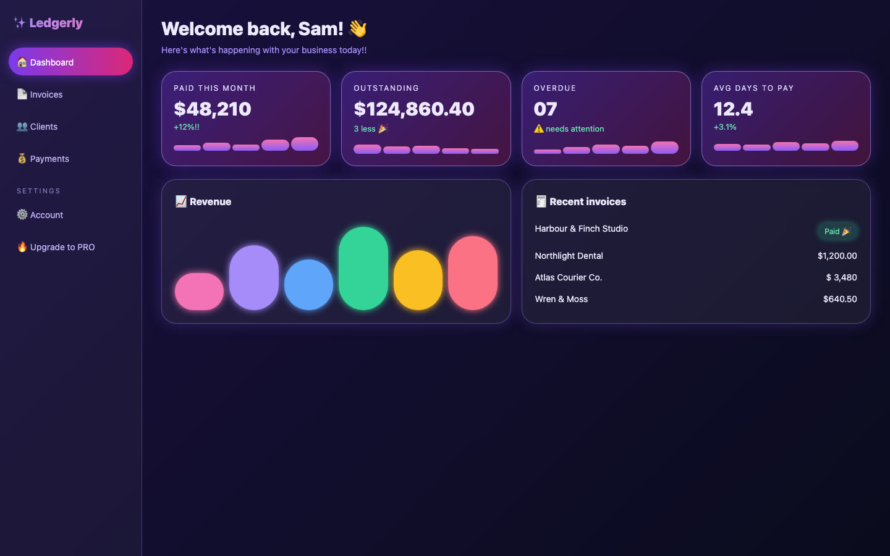
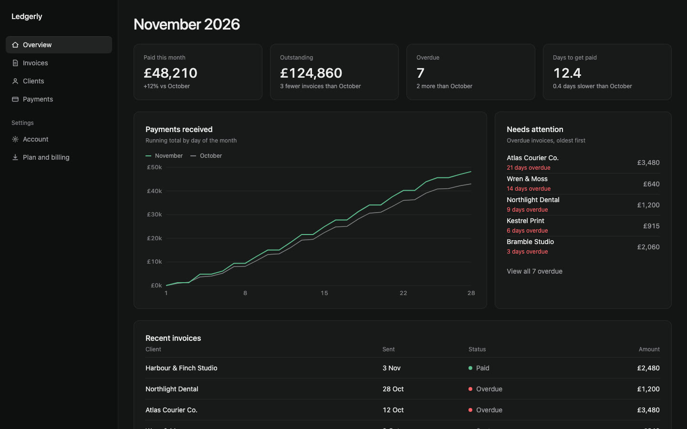
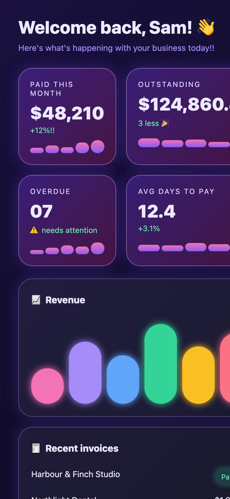
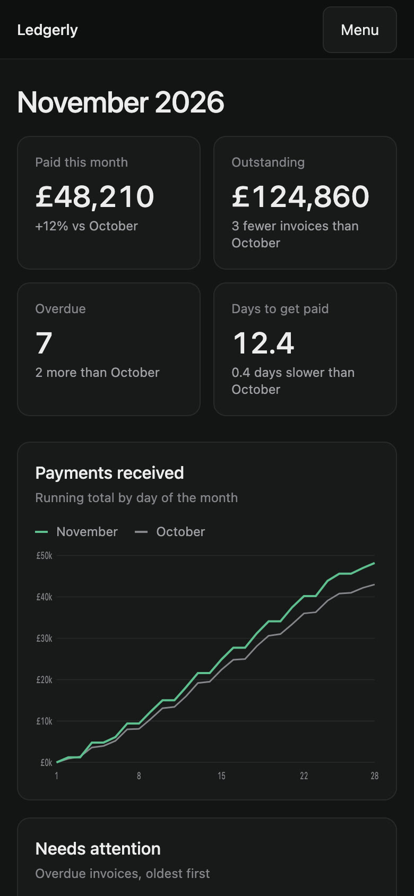

# Example: a dashboard, before and after

An app screen (Operate mode): the same product and the same data before and after an Inimitable run. The first version of `after.html` failed three of the skill's own checks and was fixed in the look step; the numbers below are for the final version.

```bash
node scripts/signs.mjs   examples/dashboard/before.html     # 9 kinds of tell, 75 in all
node scripts/signs.mjs   examples/dashboard/after.html      # none
node scripts/drift.mjs   examples/dashboard/before.html --save before.json
node scripts/drift.mjs   examples/dashboard/after.html  --against before.json
node scripts/check.mjs   examples/dashboard/after.html --widths 320,390,1440,2560
node scripts/shoot.mjs   examples/dashboard/after.html
```

| Before | After |
| --- | --- |
|  |  |
|  |  |

## What the run decided

- **Mode:** Operate. **Direction:** calm and exact, like a good instrument; never glowing or decorated.
- **The star:** the payments chart: the biggest thing on the screen, one accent line for the month being tracked, last month in neutral. Everything around it is quiet.
- **Quiet chrome:** a graphite ramp, one accent (ledger green) for the tracked month and for "paid".
- **Stats are numbers:** a label, a figure, and what it is compared with. No sparklines.
- **The title names the context** (`November 2026`), not a greeting.
- **Every figure in one format**, tabular, so columns line up.
- **Overdue list instead of a second chart**, as the second data block.

## Measured

| | Before | After |
| --- | --- | --- |
| Machine-made tells found by `signs.mjs` | 75 (9 kinds) | 0 |
| Font sizes in use | 7 | 5 |
| Font weights in use | 3 (400, 800, 900) | 2 (400, 500) |
| Spacing values off the 4 px grid | 15 | 0 |
| Text colours | 7 | 4 |
| Colour hues in use | 6 | 2 (green accent, red for overdue) |
| Drift flags | 6 | 0 |
| Scrolls sideways at 390 px | yes | no |
| Contrast, targets and names (`check.mjs`) at 320, 390, 1440, 2560 | not run | no problems |

Corner radii went from 2 to 3 (card 12, control 8, dot round): they now follow size.

## What the look step caught in the first "after"

- Overdue text at 4.49:1 contrast, just under the 4.5:1 floor. Lightened the red.
- The logo link in the phone top bar was 20 px tall. Made it a 44 px target.
- The page scrolled sideways at 320 px, because grid columns were not allowed to shrink. Fixed with `minmax(0, 1fr)`.
- The attention panel left a dead gap under three rows beside a tall chart. It now lists five overdue invoices and a link to all seven.
