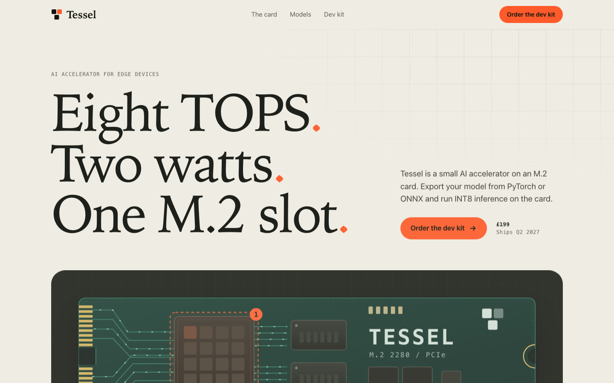
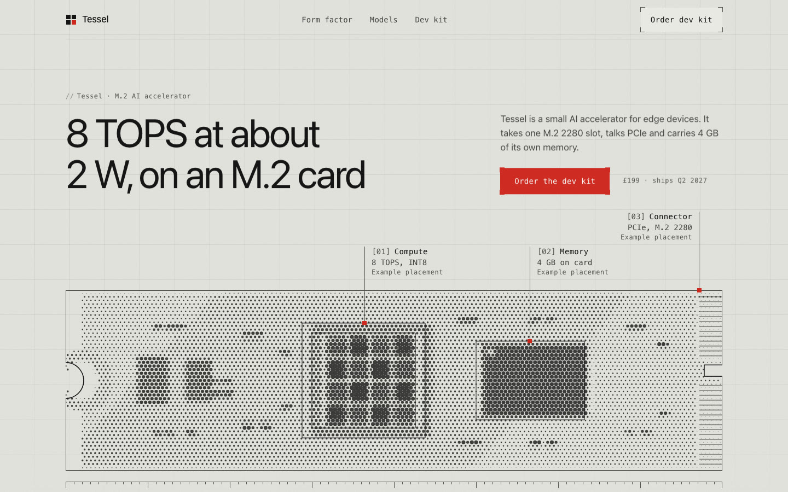
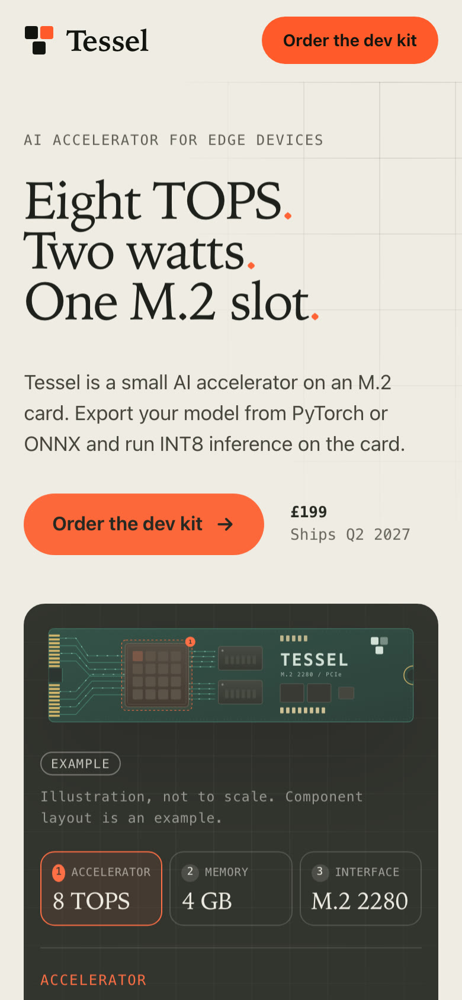
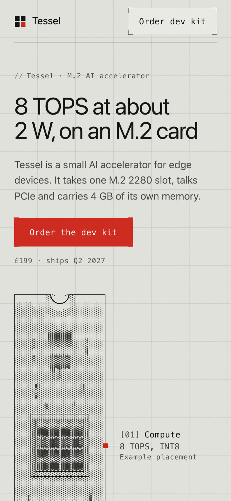

# Example: an AI accelerator landing page

The same brief, built twice by the same model: once with no design skill, once with Inimitable. The brief gave six facts (8 TOPS at about 2 W, 4 GB, M.2 2280, PyTorch and ONNX, £199, Q2 2027) and forbade inventing benchmarks, customers or specifications.

```bash
node scripts/score.mjs examples/instrument-chip/without-skill.html   # 43 / 100
node scripts/score.mjs examples/instrument-chip/with-skill.html      # 94 / 100
```

| Without the skill | With the skill |
| --- | --- |
|  |  |
|  |  |

## What the skill chose

- **Direction:** Instrument, light: a datasheet. One vermilion accent on the order button, one active tile on the die and the callout markers.
- **The hero object:** a top view of the M.2 2280 card at true proportions (80 by 22 mm), drawn as SVG, run through `scripts/dotify.mjs` in hex mode, with crisp line art, a red tile, three callouts and a millimetre ruler on top. On a phone the card turns 90 degrees and the callouts move beside it.
- **Honest labels:** every callout reads "Example placement" or "Illustration". Only facts from the brief appear as figures.

## Measured

| | Without | With |
| --- | --- | --- |
| Mechanical score | 43 | 94 |
| Machine-made tells | 3 kinds (20) | 0 |
| Contrast, target and state problems | 15 | 0 |
| Drift flags | 7 | 3 |

## An honest note

The page made without the skill drew a richer, more colourful circuit board and is attractive in its own way. The skilled page is more distinctive and keeps strictly to the brief's no-invention rule, but a coloured hardware illustration is one place the baseline was ahead. A recipe for that is on the list.
