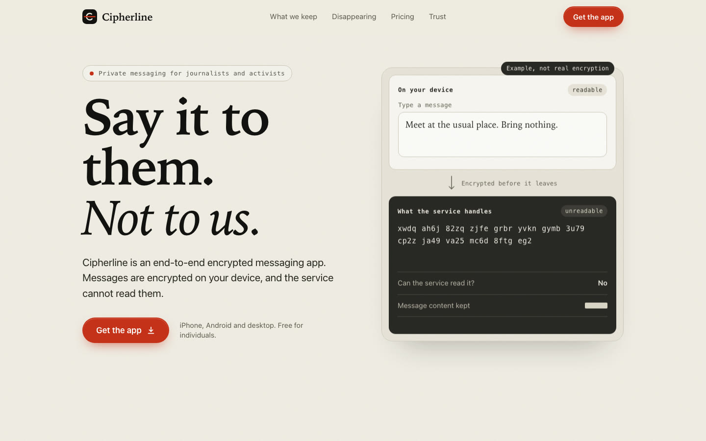
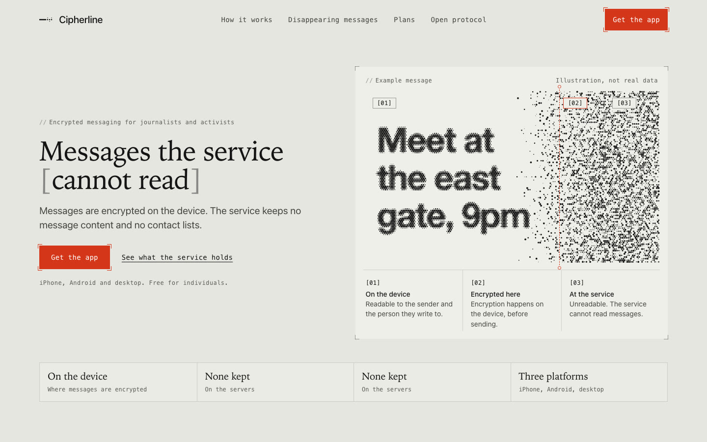
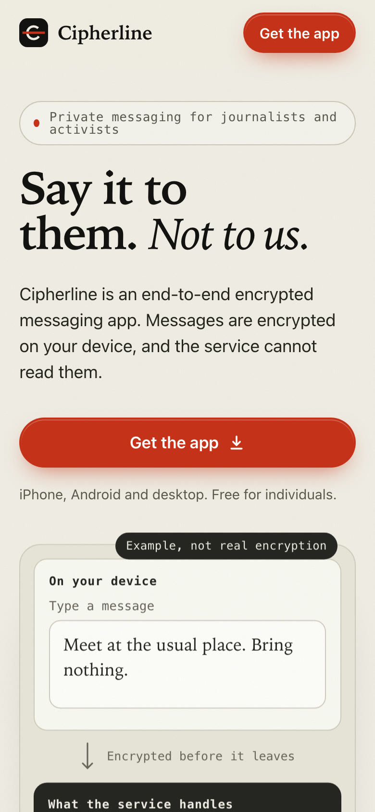
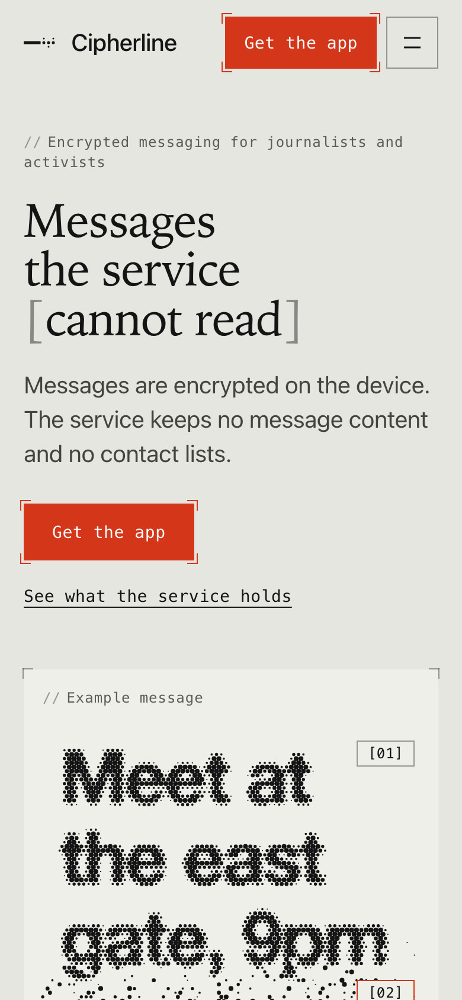

# Example: an encrypted messaging landing page

The same brief, built twice by the same model: once with no design skill, once with Inimitable. The brief gave six facts and forbade inventing user counts, certifications, audit results or any other number.

```bash
node scripts/score.mjs examples/instrument-messaging/without-skill.html   # 68 / 100
node scripts/score.mjs examples/instrument-messaging/with-skill.html      # 100 / 100
```

| Without the skill | With the skill |
| --- | --- |
|  |  |
|  |  |

## What the skill chose

- **Direction:** Instrument, light: grey paper, black ink, one vermilion accent. Chosen because nearly every security page is dark with a green glow, and a datasheet look is calmer and sets the product apart.
- **The hero object is the product's idea:** an example message in dotted letters that dissolves into noise from left to right, with a dashed "encrypted here" line and numbered pins. It was made by rendering the text, turning it into a brightness field, and dithering it with `assets/recipes/dither.mjs` (`dissolve`), then drawing the annotation with `hud.mjs`.
- **Honest labels:** everything drawn is marked "Example message" or "Illustration, not real data". No audit, count or speed is claimed.
- **Committed devices:** `//` labels, one `[bracketed]` phrase, corner-bracket buttons and frames, a stat strip. The scanner reports nothing.

## Measured

| | Without | With |
| --- | --- | --- |
| Mechanical score | 68 | 100 |
| Machine-made tells | 2 kinds | 0 |
| Contrast, target and state problems | 5 | 0 |
| Drift flags | 8 | 0 |

The "Get the app" links point at `#get` because the brief gives no store addresses; that is listed as left over, not invented.
