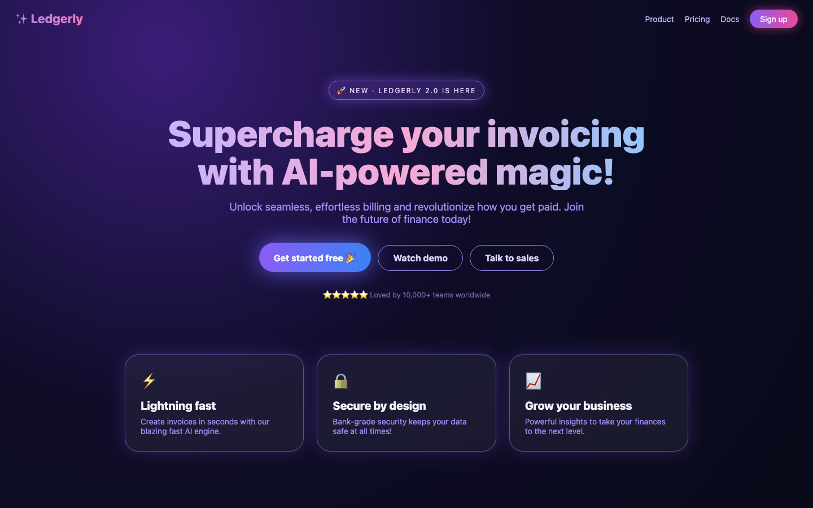
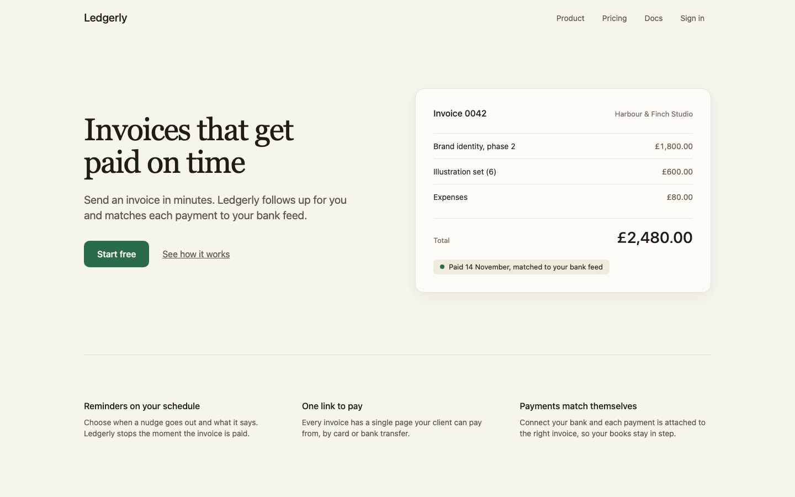
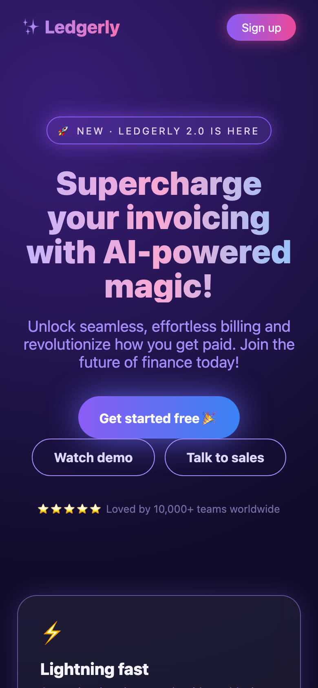
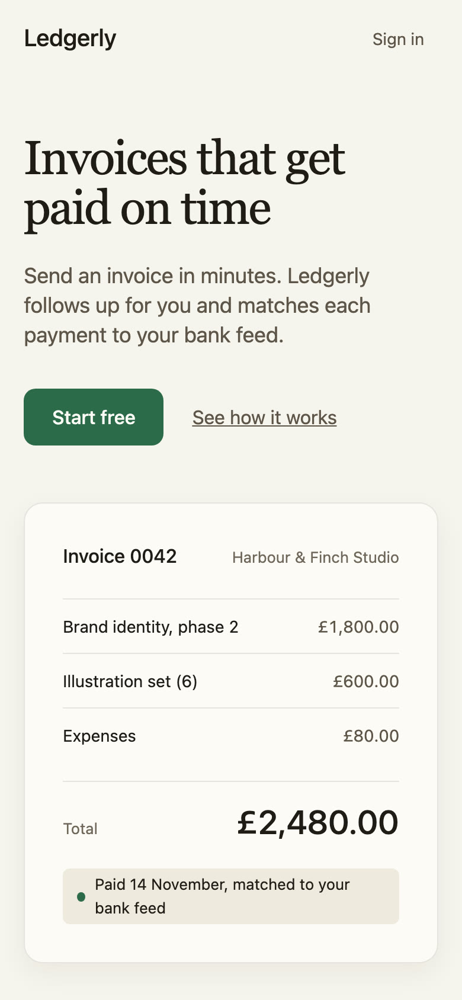

# Example: a landing page, before and after

`before.html` is a landing page built the way a model builds one when nobody decides anything. `after.html` is the same product and the same content after an Inimitable run. Open both in a browser, or run the scripts yourself:

```bash
node scripts/signs.mjs   examples/landing/before.html     # 11 kinds of tell
node scripts/signs.mjs   examples/landing/after.html      # none
node scripts/drift.mjs   examples/landing/before.html --save before.json
node scripts/drift.mjs   examples/landing/after.html  --against before.json
node scripts/check.mjs   examples/landing/after.html      # contrast, targets, names at 390 and 1440
node scripts/shoot.mjs   examples/landing/after.html      # 320, 390, 1440, 2560
```

| Before | After |
| --- | --- |
|  |  |
|  |  |

## What the run decided

- **Mode:** Persuade.
- **Direction:** calm and exact, like a good ledger; never glowing or decorated. World: paper and ink. Signature: a status dot that says what happened to the invoice.
- **The star:** the invoice itself, with believable content, in place of a gradient headline and three emoji cards.
- **One accent** (ledger green) on the primary action and the "paid" dot. Everything else is a warm neutral ramp.

## What changed, measured

Numbers from the scripts, not estimates.

| | Before | After |
| --- | --- | --- |
| Kinds of machine-made tell found by `signs.mjs` | 11 | 0 |
| Font sizes in use | 9 | 6 |
| Font weights in use | 4 (700, 800, 900) | 2 (400, 500) |
| Spacing values off the 4 px grid | 15 | 0 |
| Text colours | 7 | 4 |
| Drift flags | 6 | 0 |
| Touch-target problems at 390 px | 3 | 0 |

Two numbers went up on purpose and are stated here rather than hidden: font families went from 1 to 2 (a serif for the headline only) and corner radii from 2 to 4 (the radii now follow size: tag 6, button 10, card 16, dot round).

## What was removed, and not replaced with anything else

Hue-to-hue gradients on the page, the headline and both buttons; coloured glows and the pulsing button; the "New" pill with its rocket; seven emoji; the "Loved by 10,000+ teams" claim (nothing on the page supported it); the hype words and exclamation marks; three heavy weights; the uppercase tracked pill; two extra buttons in the hero.

The copy now says what the product does: send an invoice, get followed up for, payments matched to the bank feed.
