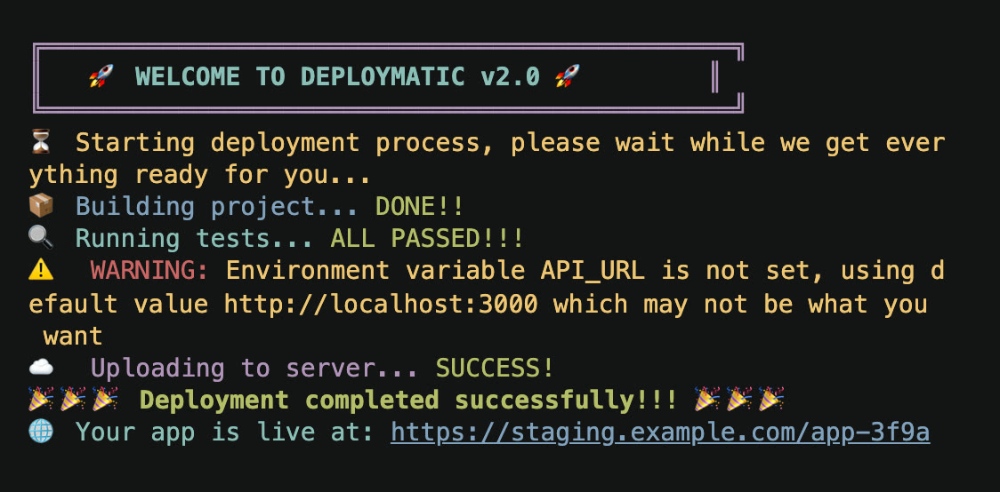
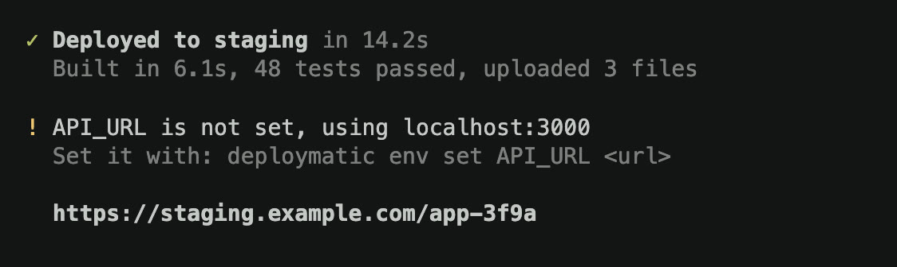

# Example: a terminal command, before and after

The same fictional deploy command, printed two ways. `before.mjs` is how a model usually writes CLI output. `after.mjs` is the same information after a terminal-mode Inimitable run.

```bash
node scripts/term-shot.mjs --cols 60  --label before -- node examples/terminal/before.mjs
node scripts/term-shot.mjs --cols 60  --label after  -- node examples/terminal/after.mjs
node scripts/term-shot.mjs --cols 120 --label after  -- node examples/terminal/after.mjs
node scripts/term-shot.mjs --cols 60  --label after --no-color -- node examples/terminal/after.mjs
```

| Before, 60 columns | After, 60 columns |
| --- | --- |
|  |  |

## Measured

| | Before | After |
| --- | --- | --- |
| Lines at 60 columns | 13 | 7 |
| Lines wrapped by the width at 60 columns | 3 | 0 |
| Lines wrapped by the width at 120 columns | 1 | 0 |
| Colours used | 6 | 2 (green and yellow, each with one meaning) |
| Emoji | 14 | 0 |
| Readable without colour | no (meaning lives in colour and emoji) | yes (`✓` and `!` carry it) |

## What the run decided

- **Mode:** Terminal. The star is the result line: `✓ Deployed to staging in 14.2s`.
- The banner, the box and the "please wait" line went; progress belongs on one line that is replaced by the result.
- The warning says what is wrong and what to do about it, on the next line, quieter.
- The detail text wraps at the real terminal width, not a guess.
- The address is the last thing and is set apart, because it is what the person came for.

The first version of `after.mjs` wrapped its warning at 60 columns. `term-shot.mjs` reported it, and the message was shortened. That is the loop the skill runs for every screen.
